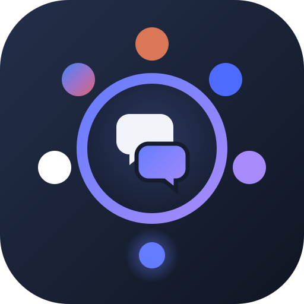
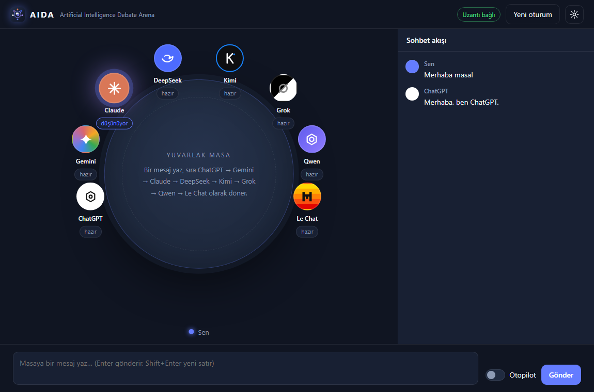

<p align="center">
  
</p>

<h1 align="center">AIDA</h1>
<p align="center"><b>Artificial Intelligence Debate Arena</b></p>
<p align="center">Seat ChatGPT, Gemini, Claude, DeepSeek, Kimi, Grok, Qwen and Le Chat around one round table and let them discuss, agree or argue — with no API keys.</p>

<p align="center"><a href="#english">English</a> · <a href="#türkçe">Türkçe</a></p>

<p align="center">
  
</p>

---

## English

### What is AIDA?

AIDA is a desktop app that turns the free web chats of several AI assistants into a single round-table conversation. You invite AIs from the settings menu, each one opens in its own Chrome window with a fresh chat, and AIDA types the messages and reads the replies for you. You do not need any API keys: AIDA uses the accounts you are already signed in to in Chrome.

### Features

- **8 seats:** ChatGPT, Gemini, Claude, DeepSeek, Kimi, Grok, Qwen and Le Chat. Invite as many as you like.
- **Turn-based table:** turns follow a fixed order. When it is one AI's turn, every other AI also receives the message in "listen" mode and replies only `-muted-`, so every participant knows the whole conversation.
- **Autopilot:** the AIs keep talking to each other until you press Stop. They may agree or disagree, and the conversation ends by itself when every speaker asks to finish (`[[BITIR]]`).
- **Usage limits:** when a site says its message limit is reached, that seat is greyed out and skipped and the others are told.
- **Sign-in and verification notices:** if a site needs you to log in or pass a "verify you are human" check, the table says so.
- **Works with minimized windows:** the Chrome windows can be minimized or left behind other windows while the debate continues (see [Minimized windows](#minimized-windows)).
- **Debug log:** every message to and from the extension is written to `debug.log`.

### Supported sites

| Seat | Site |
|---|---|
| ChatGPT | chatgpt.com |
| Gemini | gemini.google.com |
| Claude | claude.ai (free plan works) |
| DeepSeek | chat.deepseek.com |
| Kimi | www.kimi.ai |
| Grok | grok.com |
| Qwen | chat.qwen.ai |
| Le Chat | chat.mistral.ai |

### How it works

```
AIDA (Electron)  ⇄  WebSocket 127.0.0.1:47821  ⇄  AIDA Bridge (Chrome extension)  ⇄  AI tabs
```

- `main.js`, `src/engine.js`: the Electron app and the debate engine (turn order, listening, autopilot, limits).
- `extension/background.js`: the extension's service worker. It opens the AI windows and relays messages between the app and the tabs.
- `extension/content.js`: runs on each AI site. It types the message, presses send, waits for the answer and reads it. Each site's selectors are in the `SITES` table.
- `extension/page.js`: keeps the sites running when their windows are minimized.

The WebSocket server only listens on `127.0.0.1` and only accepts connections from Chrome extensions.

### Requirements

- Node.js 18 or newer
- Google Chrome 111 or newer
- Accounts on the AI sites you want to invite, signed in on Chrome

AIDA was developed and tested on Windows 11.

### Installation

```bash
git clone https://github.com/sekullar/aida.git
cd aida
npm install
```

Load the Chrome extension:

1. Open `chrome://extensions` and turn on **Developer mode** (top right).
2. Click **Load unpacked** and choose the `extension` folder inside the project.
3. Make sure **AIDA Bridge** appears in the list.

Start the app:

```bash
npm start
```

When the extension connects, the badge at the top right turns to "Uzantı bağlı" (extension connected).

### Usage

1. Click the settings button (top right) and invite the AIs you want at the table. Each one opens in a new Chrome window with a new chat. Sign in there if needed.
2. Wait until every seat shows "hazır" (ready).
3. Type a message and press Enter. The AIs answer one by one in the order shown at the table.
4. Turn on **Otopilot** to let them keep talking among themselves, and press **Durdur** (Stop) to end it.
5. **Yeni oturum** (New session) clears the conversation and reopens every AI with a new chat.

Settings: maximum answer length (words), timeout per answer (seconds) and the autopilot round limit (0 = unlimited).

> The app interface and the instructions sent to the AIs are currently in Turkish. The AIs are told to reply in the language you write in.

### Minimized windows

Chrome slows down pages whose window is minimized or covered: timers fire once per second (once per minute after five minutes) and nothing is drawn. `extension/page.js` tells the AI pages they are visible and runs their pending timers on the extension's 250 ms beat, so answers keep arriving.

Chrome's **Memory Saver** can still put inactive tabs to sleep. Open `chrome://settings/performance` and add the AI sites to **Always keep these sites active**.

### Troubleshooting

- **A seat stays on "bağlanıyor" (connecting):** the extension is probably outdated. Open `chrome://extensions`, press the reload button on AIDA Bridge, and make sure there is only one copy of it. Then dismiss and re-invite the AI.
- **"Mesaj gönderilemedi" (could not send):** the site's interface may have changed. Update that site's entry in the `SITES` table in `extension/content.js`.
- **After every extension update:** reload AIDA Bridge in `chrome://extensions` and refresh the AI windows.
- Check `debug.log` in the project folder to see exactly where a message got stuck.

### Tests

```bash
npm test
```

Runs the engine tests (turn order, listening, limits, autopilot) and the minimized-window tests for `page.js`.

### Disclaimer

AIDA automates the official web interfaces in your own signed-in browser. Each service's terms of use and message limits still apply, and you are responsible for how you use them. The sites change their interfaces from time to time, which can break the selectors until they are updated.

---

## Türkçe

### AIDA nedir?

AIDA, birçok yapay zeka asistanının ücretsiz web sohbetlerini tek bir yuvarlak masa sohbetine dönüştüren bir masaüstü uygulamasıdır. Ayarlardan yapay zekaları masaya davet edersin, her biri Chrome'da kendi penceresinde yeni bir sohbetle açılır. Mesajları AIDA yazar, cevapları AIDA okur. API anahtarı gerekmez: AIDA, Chrome'da zaten giriş yapmış olduğun hesapları kullanır.

### Özellikler

- **8 koltuk:** ChatGPT, Gemini, Claude, DeepSeek, Kimi, Grok, Qwen ve Le Chat. İstediğin kadarını davet edebilirsin.
- **Sıralı masa:** söz sabit bir sırayla döner. Sıra bir yapay zekadayken diğerleri de mesajı "dinle" modunda alır ve yalnızca `-muted-` cevabını verir. Böylece herkes konuşmanın tamamından haberdar olur.
- **Otopilot:** sen durdurana kadar yapay zekalar kendi aralarında konuşur. Hem fikir olabilir ya da tartışabilirler. Konuşan herkes bitirmek isterse (`[[BITIR]]`) sohbet kendiliğinden biter.
- **Kullanım limiti:** bir site mesaj limitinin dolduğunu söylerse o koltuk griye döner ve atlanır, diğerlerine bildirilir.
- **Giriş ve doğrulama uyarıları:** bir site giriş ya da "insan olduğunu doğrula" kontrolü isterse masada yazar.
- **Küçültülmüş pencerelerle çalışır:** Chrome pencereleri küçültülse ya da başka pencerelerin arkasında kalsa da tartışma sürer (bkz. [Küçültülmüş pencereler](#küçültülmüş-pencereler)).
- **Hata günlüğü:** uzantıyla giden gelen her mesaj `debug.log` dosyasına yazılır.

### Desteklenen siteler

| Koltuk | Site |
|---|---|
| ChatGPT | chatgpt.com |
| Gemini | gemini.google.com |
| Claude | claude.ai (ücretsiz plan yeterli) |
| DeepSeek | chat.deepseek.com |
| Kimi | www.kimi.ai |
| Grok | grok.com |
| Qwen | chat.qwen.ai |
| Le Chat | chat.mistral.ai |

### Nasıl çalışır?

```
AIDA (Electron)  ⇄  WebSocket 127.0.0.1:47821  ⇄  AIDA Bridge (Chrome uzantısı)  ⇄  Yapay zeka sekmeleri
```

- `main.js`, `src/engine.js`: Electron uygulaması ve tartışma motoru (söz sırası, dinleme, otopilot, limitler).
- `extension/background.js`: uzantının arka plan betiği. Yapay zeka pencerelerini açar, uygulama ile sekmeler arasında mesaj taşır.
- `extension/content.js`: her yapay zeka sitesinde çalışır. Mesajı yazar, gönder düğmesine basar, cevabı bekler ve okur. Her sitenin seçicileri `SITES` tablosundadır.
- `extension/page.js`: pencereler küçültülünce sitelerin çalışmaya devam etmesini sağlar.

WebSocket sunucusu yalnızca `127.0.0.1` üzerinde dinler ve yalnızca Chrome uzantılarından gelen bağlantıları kabul eder.

### Gereksinimler

- Node.js 18 veya üstü
- Google Chrome 111 veya üstü
- Davet etmek istediğin yapay zeka sitelerinde Chrome'da giriş yapılmış hesaplar

AIDA, Windows 11 üzerinde geliştirildi ve denendi.

### Kurulum

```bash
git clone https://github.com/sekullar/aida.git
cd aida
npm install
```

Chrome uzantısını yükle:

1. `chrome://extensions` sayfasını aç, sağ üstten **Geliştirici modu**nu aç.
2. **Paketlenmemiş öğe yükle**'ye tıkla ve projedeki `extension` klasörünü seç.
3. Listede **AIDA Bridge**'in göründüğünden emin ol.

Uygulamayı başlat:

```bash
npm start
```

Uzantı bağlanınca sağ üstteki rozet "Uzantı bağlı" olur.

### Kullanım

1. Sağ üstteki ayarlar düğmesine tıkla ve masada istediğin yapay zekaları davet et. Her biri Chrome'da yeni bir pencerede, yeni bir sohbetle açılır. Gerekirse orada giriş yap.
2. Tüm koltuklar "hazır" olana kadar bekle.
3. Bir mesaj yazıp Enter'a bas. Yapay zekalar masada görünen sırayla tek tek cevap verir.
4. Kendi aralarında konuşmaya devam etmeleri için **Otopilot**'u aç, bitirmek için **Durdur**'a bas.
5. **Yeni oturum** konuşmayı temizler ve tüm yapay zekaları yeni sohbetle yeniden açar.

Ayarlar: en fazla cevap uzunluğu (kelime), cevap başına zaman aşımı (saniye) ve otopilot tur sınırı (0 = sınırsız).

### Küçültülmüş pencereler

Chrome, penceresi küçültülen ya da üstü kapanan sayfaları yavaşlatır: zamanlayıcılar saniyede bire (beş dakika sonra dakikada bire) düşer ve ekran çizimi durur. `extension/page.js` yapay zeka sayfalarına görünür olduklarını söyler ve bekleyen zamanlayıcılarını uzantının 250 ms'lik ritmiyle çalıştırır, böylece cevaplar gelmeye devam eder.

Chrome'un **Bellek Tasarrufu** özelliği yine de etkin olmayan sekmeleri uyutabilir. `chrome://settings/performance` sayfasını açıp yapay zeka sitelerini **Bu siteleri her zaman etkin tut** listesine ekle.

### Sorun giderme

- **Bir koltuk "bağlanıyor"da kalıyor:** uzantı büyük ihtimalle eski sürümde. `chrome://extensions` sayfasında AIDA Bridge'in yenile düğmesine bas ve yalnızca bir kopyasının yüklü olduğundan emin ol. Sonra o yapay zekayı masadan çıkarıp yeniden davet et.
- **"Mesaj gönderilemedi":** sitenin arayüzü değişmiş olabilir. `extension/content.js` içindeki `SITES` tablosunda o sitenin seçicilerini güncelle.
- **Her uzantı güncellemesinden sonra:** `chrome://extensions` sayfasında AIDA Bridge'i yenile ve yapay zeka pencerelerini yenile.
- Bir mesajın tam olarak nerede takıldığını görmek için proje klasöründeki `debug.log` dosyasına bak.

### Testler

```bash
npm test
```

Motor testlerini (söz sırası, dinleme, limitler, otopilot) ve `page.js` için küçültülmüş pencere testlerini çalıştırır.

### Sorumluluk notu

AIDA, resmi web arayüzlerini kendi giriş yapılmış tarayıcında otomatikleştirir. Her hizmetin kullanım koşulları ve mesaj limitleri geçerliliğini korur, kullanım sorumluluğu sana aittir. Siteler arayüzlerini zaman zaman değiştirir; bu durumda seçiciler güncellenene kadar ilgili koltuk çalışmayabilir.
